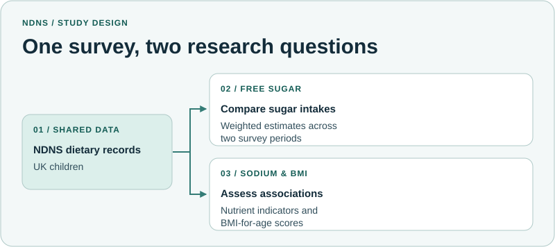

# NDNS Dietary Research

Two studies of what children in the UK eat and how dietary indicators relate to BMI-for-age, using the National Diet and Nutrition Survey (NDNS).

## Free sugar, fructose and sucrose

*Dietary-weighted free-sugar, fructose and sucrose intakes among children in two National Diet and Nutrition Survey rolling programme periods: a descriptive comparison*

| | |
| --- | --- |
| **Research question** | How did dietary-weighted free sugar, fructose and sucrose intakes differ between the two NDNS periods among children aged 5–16? |
| **Data** | NDNS Years 1–9 used food diaries and day-average estimates. Years 12–15 used Intake24 recalls and usual-intake estimates. |
| **Method** | Compare weighted estimates overall and by age and sex. Report free sugar in grams per day and as a percentage of total energy. Interpret the comparison in light of the different assessment and estimation methods. |

## Nutrient indicators and BMI-for-age

**Working title**  
*Nutrient-Level Dietary Indicators and BMI-for-Age Standard Deviation Scores in UK Children: A Cross-Sectional Analysis of United Kingdom National Diet and Nutrition Survey Data*

| | |
| --- | --- |
| **Research question** | How are nutrient indicators, including sodium, associated with BMI-for-age in UK children? |
| **Data** | Dietary and anthropometric records for children aged 4–18 from NDNS Years 1–9. |
| **Method** | Fit regression models for age- and sex-standardised BMI-for-age scores, adjusting for age, sex, total energy intake and survey year. Compare weighted and unweighted estimates and alternative model specifications. |

## What you can explore

The study diagram shows how the two NDNS analyses use different age ranges, study designs and methods.

[Back to the research portfolio](https://github.com/Shahin-Ghanbari#featured-research)
